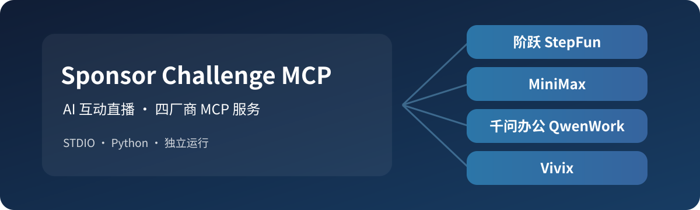

[](CHANGELOG.md)
[](pyproject.toml)
[](#功能与接口)
[](LICENSE)
[](https://github.com/ranzevor/SponsorChallengeMCP/actions/workflows/quality.yml)

# Sponsor Challenge MCP

Sponsor Challenge MCP 为 AI 互动直播提供四个可独立启动的 MCP Server：阶跃星辰、MiniMax、千问办公和 Vivix。服务对接不同厂商的模型 API，或向千问办公桌面客户端提供文件生成、投票分析工具。

项目提供本地 STDIO 接口，不提供直播弹幕采集、自动推流或 Vivix RTC 媒体播放器。模型 API 和视频生成请求使用者配置的厂商凭据；千问办公服务的本地工具无需模型凭据。

## 功能与接口

| 服务 | 启动参数 | MCP 工具 | 作用 |
|---|---|---|---|
| 阶跃 | `stepfun` | `stepfun_reason` | Step 5 Preview 文本、图像推理 |
| MiniMax | `minimax` | `minimax_chat`, `minimax_speak` | 文本推理、语音合成及 MP3 输出 |
| 千问办公 | `qwenwork` | `qwenwork_create_document`, `qwenwork_export_csv`, `qwenwork_poll_report` | DOCX、CSV 及投票分析 |
| Vivix | `vivix` | `vivix_generate_video`, `vivix_video_status`, `vivix_start_avatar`, `vivix_close_avatar`, `vivix_list_characters` | 视频生成任务和实时角色会话管理 |

这四个服务共包含 11 个 MCP 工具，可分别加载到支持本地 STDIO 的客户端。千问办公是调用本地 MCP 工具的**客户端**，不是本项目代理的「千问模型接口」。

## 最短使用路径

需要 Python 3.11 或更新版本。先取得源码并进入项目目录，以下为 Windows PowerShell 命令：

```powershell
git clone https://github.com/ranzevor/SponsorChallengeMCP.git
cd SponsorChallengeMCP
python -m venv .venv
.\.venv\Scripts\python.exe -m pip install .
.\.venv\Scripts\python.exe -m sponsor_mcp qwenwork
```

不使用 Git 时，可在[仓库首页](https://github.com/ranzevor/SponsorChallengeMCP)选择 **Code → Download ZIP**，解压后进入包含 `pyproject.toml` 的目录，再从创建虚拟环境的命令开始。

最后一条命令启动 STDIO MCP 服务，供 MCP 客户端管理，不会自行打开图形界面。Linux/macOS 使用 `.venv/bin/python`。安装 Wheel 文件时，可将 `pip install .` 替换为 `pip install <Wheel 文件路径>`。

### 在 MCP 客户端中配置

参见 [`examples/mcp-config.json`](examples/mcp-config.json)。将其中的 `command` 设置为安装了本项目的 Python 解释器**绝对路径**，再启动对应服务：

```text
-m sponsor_mcp stepfun
-m sponsor_mcp minimax
-m sponsor_mcp qwenwork
-m sponsor_mcp vivix
```

千问办公桌面端：**扩展 → 连接器 → 添加 → STDIO**。在命令中使用绝对 Python 路径，参数填写 `-m sponsor_mcp qwenwork`。其他支持本地 STDIO 的客户端可分别配置四个入口。

三个远端厂商服务使用独立的环境变量：

| 环境变量 | 用途 |
|---|---|
| `STEPFUN_API_KEY` | 阶跃开放平台密钥 |
| `MINIMAX_API_KEY` | MiniMax 开放平台密钥 |
| `VIVIX_API_KEY` | Vivix 开发者密钥 |
| `SPONSOR_MCP_OUTPUT_DIR` | DOCX、CSV、MP3 输出目录；默认 `~/SponsorMCPOutputs` |

只向相应服务提供它所需的 API Key；未设置密钥的远端工具会拒绝发起请求。`.env.example` 描述变量，但程序不会自行读取 `.env`。

### 卸载与重新安装

先在 MCP 客户端中停止对应服务，并移除不再使用的 `sponsor-stepfun`、`sponsor-minimax`、`sponsor-qwenwork` 或 `sponsor-vivix` 配置项，再用安装时的同一个 Python 解释器卸载：

```powershell
.\.venv\Scripts\python.exe -m pip uninstall sponsor-challenge-mcp
```

恢复安装时，在项目根目录使用同一个解释器执行：

```powershell
.\.venv\Scripts\python.exe -m pip install .
```

也可将 `.` 替换为所需版本的 Wheel 文件路径。重新添加 MCP 配置时，让 `command` 指向该解释器的绝对路径。Linux/macOS 将上述解释器替换为 `.venv/bin/python`。卸载和重装不会删除输出目录中已生成的 DOCX、CSV 或 MP3；这些文件由使用者保留或按需清理。

### 工具使用示例

**阶跃：** 在 `stepfun_reason` 传入 `prompt`、可选公开 HTTPS `image_url` 和 `reasoning_effort`。

**MiniMax：** 用 `minimax_chat` 生成台词，再由 `minimax_speak` 合成 MP3，结果保存在输出目录中。单次 MP3 音频上限为 8 MiB。

**千问办公：** 由千问办公调用 `qwenwork_poll_report` 统计已有投票数据，再调用 `qwenwork_create_document` 输出 DOCX 或 `qwenwork_export_csv` 输出 CSV。投票数据由使用者提供，不自动获取弹幕。

**Vivix：** 用 `vivix_generate_video` 提交视频生成任务，再通过 `vivix_video_status` 查询任务完成结果。`vivix_start_avatar` 创建实时角色会话并返回控制/媒体连接参数；音视频播放和 WebSocket 交互由外部客户端实现，结束时使用 `vivix_close_avatar` 关闭会话。

使用 `dialogue` 生成视频语音时，可通过 `tts_provider` 和 `tts_model_id` 选择语音提供商及其匹配模型；使用 `audio_url` 时不传语音合成参数。实时角色会话也支持这两个参数，选择非默认语音提供商时需同时提供匹配的 `tts_model_id`。音色使用 `voice_id` 指定，具体取值应与所选提供商对应。

## 运行约束

- 远端 API 仅向各服务预设的 HTTPS 官方主机发送 Bearer 凭据；环境变量可覆盖路径，但不能改变主机。
- 文件工具仅写入 `SPONSOR_MCP_OUTPUT_DIR`，不会访问 B 站用户数据或远端直播间。
- 视频生成、语音生成及实时会话可能使用厂商额度；任务已提交和结果已生成是不同状态。
- MCP 服务通过 JSON-RPC 2.0 STDIO 工作；错误的工具参数返回协议错误，业务失败在工具结果中标记。

## 开发、版本与支持

开发环境安装和测试：

```powershell
.\.venv\Scripts\python.exe -m pip install -e ".[test]"
.\.venv\Scripts\python.exe -m pytest
```

当前版本为 `0.1.0`，公开接口位于各 MCP 工具的 `inputSchema`，通过工具发现提供。以 Python 3.11+ 作为运行前置，远端厂商能力按所用 API 凭据和对应版本启用。变化见 [CHANGELOG](CHANGELOG.md)，协作说明见 [CONTRIBUTING](CONTRIBUTING.md)，安全问题见 [SECURITY](SECURITY.md)。

功能建议和一般缺陷请提交到[仓库 Issues](https://github.com/ranzevor/SponsorChallengeMCP/issues)，说明受影响的服务、版本和复现步骤。

## 官方接口资料

- [阶跃 Step 5 Preview](https://platform.stepfun.com/cookbook/step-5-reasoning)
- [MiniMax 模型 API](https://platform.minimax.cn/docs/guides/text-generation)
- [MiniMax 语音合成](https://platform.minimax.cn/docs/api-reference/speech-t2a-http)
- [千问办公 MCP 连接器](https://help.aliyun.com/zh/qwenwork/qw-connectors)
- [Vivix API](https://docs.vivix.ai/overview/introduction)
- [B站活动入口](https://www.bilibili.com/blackboard/era/WsYesNOi70KFziKJ.html)

## 许可与维护

Copyright 2026 Ranzevor。源码、配置、文档及自有图形按 [Apache License 2.0](LICENSE) 授权；依赖库按各自许可证发布。本项目不内置厂商模型、商标或 API 凭据。维护者：**Ranzevor**。安全联系见 [SECURITY](SECURITY.md)。
